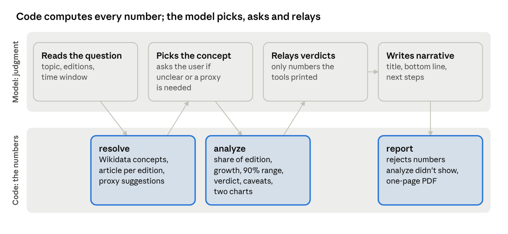

# wiki-skill

This repository holds one Agent Skill: **[wiki-interest](wiki-interest/)**. It helps B2C
founders decide which topics to build next and which languages to launch in. Ask your agent a
plain question, and it answers from Wikipedia pageview data with a verdict per language, how far
to trust it, charts, and a one-page PDF report.



The model decides and words things; the code computes every number. That is why it works well
even on small, cheap models: 27 of 30 eval runs passed on Claude Haiku 4.5.

## Install

In Claude Code, as a plugin (use the local path until the repo is on GitHub):

```
claude plugin marketplace add VadymShkarbul/wiki-skill   # or: /path/to/wiki-skill
claude plugin install wiki-interest@wiki-skill
```

For Codex, or a plain skill folder, copy `wiki-interest/` to `~/.agents/skills/` (Codex) or
`~/.claude/skills/` (Claude Code). Needs [uv](https://docs.astral.sh/uv/) and internet access.

## Learn more

The [skill's README](wiki-interest/README.md) covers:
- how it works, step by step, with real output;
- what you get;
- how to read the results;
- install details;
- quality, limits and privacy.

Everything the skill needs lives in `wiki-interest/`. The repo root holds this README, the MIT
[LICENSE](LICENSE), and the Claude Code marketplace file (`.claude-plugin/`).
