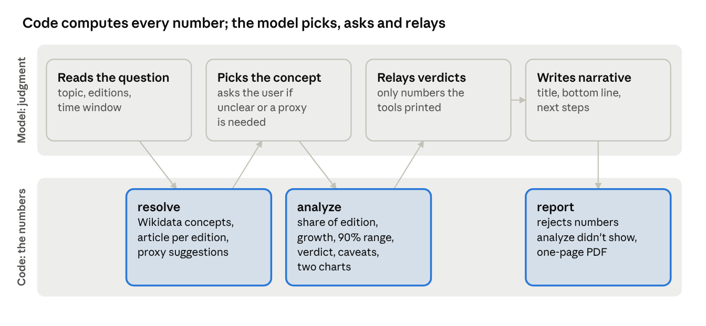
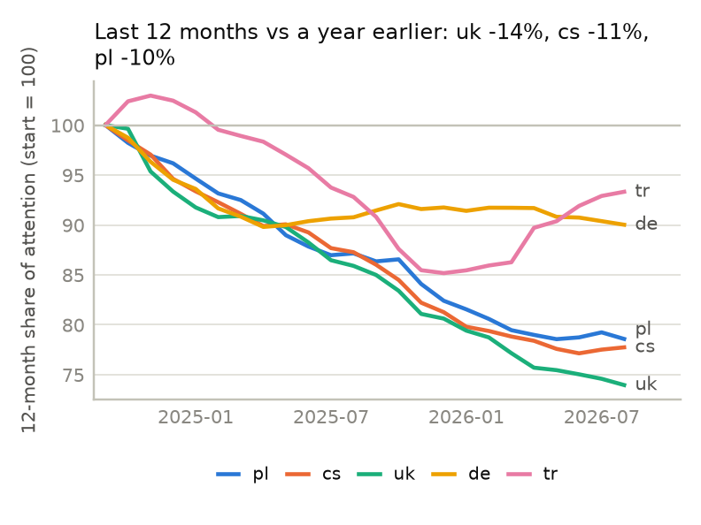
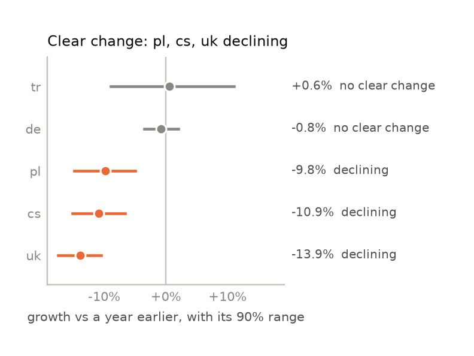
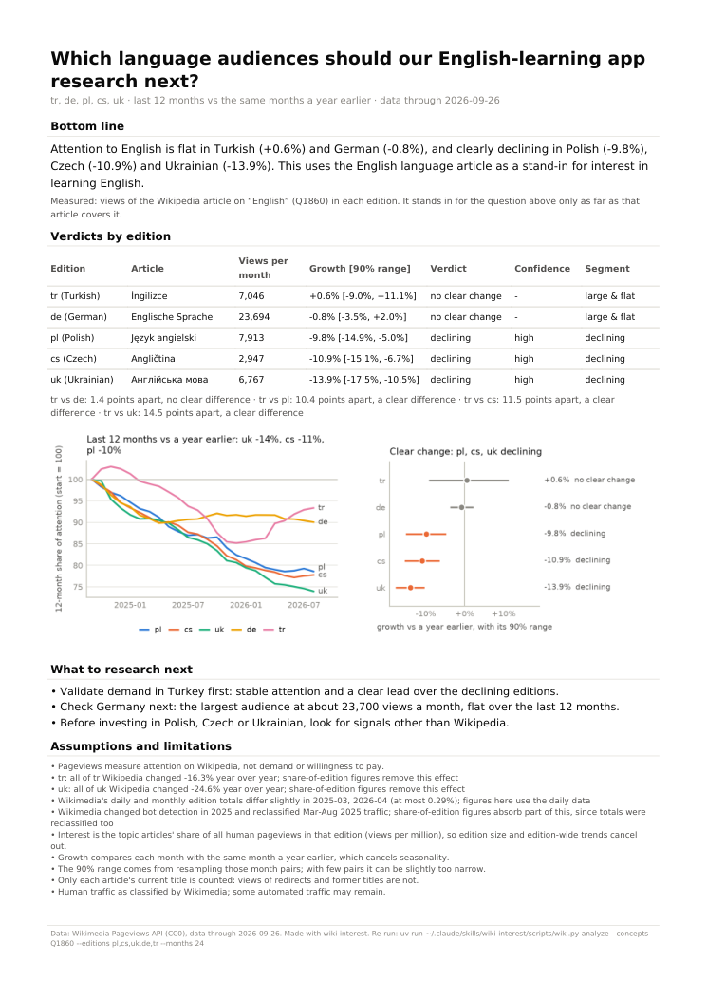
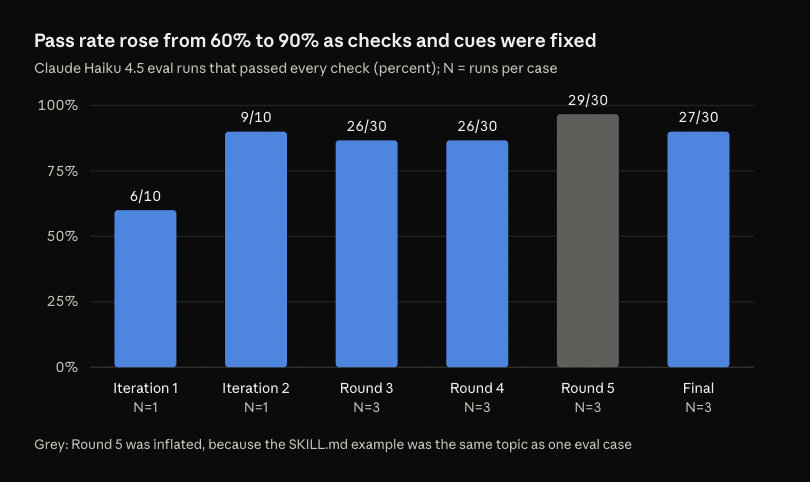

# wiki-interest

An Agent Skill that helps B2C founders decide which topics to build next and which languages to
launch in. Ask your agent a question in plain words ("Is interest in astronomy growing in
Ukrainian Wikipedia, and can we trust it?"). It answers with a verdict per language, how far to
trust it, the caveats that matter, two charts, and a one-page PDF you can share.

It works with Claude Code, Codex and other agents that support
[Agent Skills](https://agentskills.io), including small, cheap models such as Claude Haiku 4.5.

> **What it measures:** attention on Wikipedia, not demand or willingness to pay. Use the
> results to choose what to validate next, not as proof that people will buy.

## Questions it answers

You don't need to mention Wikipedia or pageviews; the agent picks the skill from the question.

- "Compare the growth of interest in intermittent fasting in Polish and Czech Wikipedia over
  the last two years."
- "We're thinking of adding an astronomy course. Is interest growing in Ukrainian, and how much
  can we trust that?"
- "We're building a language-learning app. Compare interest in learning English in the Polish,
  Czech, Ukrainian, German and Turkish Wikipedias and prepare a short report: which audiences
  should we research next, and why?"
- Follow-ups: "Add Slovak and use three years instead", "Yes, use the Polish proxy",
  "Make that a PDF in Ukrainian".

## How it works



The model decides and words things. Three commands do all the data work, and each ends with an
exact `Next:` step for the model. That split is why a small model gets reliable results: it never
computes a statistic or guesses an article title.

### 1. `resolve`: find the same topic in every language

The agent turns your topic into a Wikidata concept, which links to the article on that concept
in each language edition. This guarantees that "Polish vs Czech" compares the same thing.

```
Candidates for 'intermittent fasting' · editions: pl (Polish), cs (Czech)
1. Q1666254 intermittent fasting: a diet that cycles between a period of fasting and non-fasting · 31 Wikipedias
   pl: NOT COVERED (no article on this concept)
       possible proxies, only if the user agrees: "Post" (broader concept: fasting, Q44602); "Dieta" (broader concept: diet, Q474191)
   cs: Přerušovaný půst
```

- **Several meanings** ("Mercury": planet, element, god): the agent asks which one you mean.
- **No article in a language:** that edition is reported as not covered, never counted as zero.
  A broader article can stand in as a *proxy*, but only after you agree, and it is labeled as a
  proxy everywhere.
- Topics can be written in any language, e.g. "інтервальне голодування".

### 2. `analyze`: measure interest, growth and trust

For each edition it fetches the daily pageview history since 2015 (one request, cached for a
day), then prints a summary the agent passes on:

```
cs (Czech) · Přerušovaný půst
  DECLINING -47.7% [90% range -62.5% to -27.9%] · confidence MEDIUM · 146 views/month
  - consistent: 11 of 12 months below the same month last year
  - spike-driven: without 10 spike days growth is -34.4%

pl (Polish): NOT COVERED (no article on these concepts). Tell the user and ask whether to use a proxy ...
```

It also saves `analysis.json` and two charts in `./wiki-interest-runs/<run>/`.

### 3. `report`: a one-page PDF

When you ask for something shareable, the agent writes three parts: a title, a short bottom line,
and what to research next. The code adds everything else: the verdict table, both charts,
what was measured, the caveats and the method notes.

Before rendering, `report` checks the agent's text. Every number must be one the analysis
printed (rounding is fine); numbers you gave it, such as your growth threshold, are declared
separately. An invented statistic is rejected, so it can't reach your PDF. Labels come in
English or Ukrainian.

## What you get

For the language-learning question above (English in five editions):

| Trend: 12-month rolling share of attention | Growth vs a year earlier, with its 90% range |
|---|---|
|  |  |

<a href="docs/images/example-report.png"></a>

*The one-page report, with the charts redrawn in the report's language. Click to enlarge.*

## How to read the results

| Term | Meaning |
|---|---|
| **Interest** | The topic's share of all human pageviews in that language edition (views per million). Edition size and edition-wide traffic swings cancel out; raw views per month are shown too, for audience size. |
| **Growth** | The last 12 full months compared with the same months a year earlier, so seasonality cancels out. |
| **90% range** | How far growth could plausibly be off, from resampling those month pairs. |
| **Growing / declining** | The whole 90% range is above / below zero. |
| **No clear change** | The range includes zero: the data can't tell a trend from noise. Not the same as "declining". |
| **Confidence** | Starts high and drops one level each if months disagree (fewer than 9 of 12), growth depends on a few spike days, or the audience is under 100 views a month. |
| **Insufficient data** | Less than a year of comparison history, or under 30 views a month. |
| **Segment** | "Large" or "small" compared with the other editions, combined with the verdict, e.g. "large & flat". |
| **Caveats** | What could mislead: a proxy, a renamed or new article, a large edition-wide swing, Wikimedia's 2025 bot-detection change. |

The method in detail, for when you want to check the numbers yourself:
[references/methodology.md](references/methodology.md).

## Tuning it to your question

Just say it in the conversation; the agent maps it to these options.

| You say | The agent uses |
|---|---|
| "over the last three years" | `--months 36` (growth still compares the last 12 months with the year before) |
| "only care about audiences above 5,000 readers a month" | `--sort size`, and `--user-numbers 5000` so the report may quote your bar |
| "astronomy as a whole, not one article" | several concepts measured together, e.g. `--concepts Q333 Q544` (astronomy + Solar System) |
| "yes, use the Polish fasting article" | `--proxy pl:Post` |
| "make it in Ukrainian" | `report --lang uk` |

Follow-up questions re-run from cached data, so they are fast and make few or no new requests.

## Install

Needs [uv](https://docs.astral.sh/uv/) and internet access. Dependencies are pinned in
`scripts/wiki.py.lock` and installed on first run (a few seconds). Without uv, see
[references/setup.md](references/setup.md).

### Claude Code

| Scope | How |
|---|---|
| Plugin (recommended) | `claude plugin marketplace add VadymShkarbul/wiki-skill` once the repo is on GitHub, or `claude plugin marketplace add /path/to/wiki-skill` from a local clone. Then `claude plugin install wiki-interest@wiki-skill`, or use `/plugin` inside Claude Code. The skill appears as `wiki-interest:wiki-interest`. |
| Personal | `cp -R wiki-interest ~/.claude/skills/` (or symlink it: `ln -s "$PWD/wiki-interest" ~/.claude/skills/wiki-interest`) |
| One project | Put it at `.claude/skills/wiki-interest/` in that repo |

Verified on 2026-09-27 with Claude Code 2.1.267:
- `claude plugin validate` passes for both `wiki-interest/` and the marketplace at the repo root;
- a headless Haiku run with `--plugin-dir wiki-interest` answered correctly;
- a symlinked project skill answered correctly.

### Codex

| Scope | How |
|---|---|
| Personal | `cp -R wiki-interest ~/.agents/skills/` |
| One repo | Put it at `.agents/skills/wiki-interest/` in that repo |

Codex reads the same `SKILL.md` format and picks the skill from its description, or you can
mention it as `$wiki-interest`. Codex's default sandbox has **no network**, and it writes only to
the workspace and `/tmp`, so approve the prompts for `uv run` or start Codex with
`-c 'sandbox_workspace_write.network_access=true'` (details in
[references/setup.md](references/setup.md)). The skill never writes into its own folder, so a
read-only `.agents/` is fine. Not yet run end to end in Codex here (roadmap, E1).

### Other agents

OpenCode reads `.claude/skills/` and `.agents/skills/`. Any agent that supports Agent Skills and
can run shell commands can use it.

## Quality



The skill is tested on Claude Haiku 4.5 in an isolated harness with 10 cases:
- the three questions above;
- follow-ups;
- ambiguous topics and wrong language codes;
- a question it must not trigger on.

The final run passed **27 of 30** runs, with no ad-hoc code in any of them, at about $0.05 a run.
Every failure is explained in [evals/RESULTS.md](evals/RESULTS.md), and the raw transcripts are in
[evals/evidence/](evals/evidence/).

## Limits

- It measures attention on Wikipedia, not demand, market size or willingness to pay.
- Readers increasingly get answers from search engines and AI assistants. Share of edition
  corrects for edition-wide declines, but not for topic-specific shifts to other sources.
- Only articles' current titles are counted; views through redirects are not.
- PDF reports cover Latin, Cyrillic and Greek scripts. Caveat sentences stay in English in a
  Ukrainian report.
- No forecasts, and no guessing why a spike happened.

## Data and privacy

- The skill calls only public Wikimedia APIs (pageviews, Wikidata, Wikipedia). It sends your
  topic words and edition codes, never your conversation.
- Requests carry a descriptive User-Agent, as Wikimedia requires; set your own contact with
  `WIKI_INTEREST_CONTACT`.
- Responses are cached in `~/.cache/wiki-interest` (or the temp folder if that isn't writable).
  Outputs go to `./wiki-interest-runs/`.
- Pageview data is CC0.

## More

- Every design decision with its options and evidence: [docs/decisions.md](docs/decisions.md)
- How the Wikimedia APIs actually behave: [docs/research-data-sources.md](docs/research-data-sources.md)
- How AI-written output was verified: [docs/ai-verification.md](docs/ai-verification.md)
- What comes next: [docs/roadmap.md](docs/roadmap.md)
- Development and evals: [docs/development.md](docs/development.md)

```
SKILL.md            agent instructions
scripts/            wiki.py (entry, inline deps) + wiki.py.lock + wiki_interest/ package
references/         loaded on demand: methodology.md, setup.md
assets/i18n/        report labels (en, uk)
requirements.txt    hashed fallback for installs without uv
tests/              offline tests on recorded API responses
evals/              cheap-model eval harness, cases, results, evidence
docs/               decisions, research, roadmap, verification, development, images
```

MIT license.
